  

  

  

  
  
  

---

## Things I've built

### Web and games

**[Hopeless Opus](https://hopelessopus.istemanipal.com)** · React, MongoDB
An online puzzle-adventure game for Techtatva 2026 (ISTE Manipal), built with a 17-person team. 30 minigames, a live leaderboard, 250+ registrations and 130+ people playing at once. I wrote 5 of the minigames, including a draggable three-ring cipher wheel, and the site's animated ancient-temple UI. Source is in the organisers' private repo.

**[StudentHub](https://github.com/AdvaitZeroSix/studenthub_react)** · [live](https://studenthub-react.vercel.app/) · React, Node, Express, MongoDB
Tasks, notes, an income/expense tracker and a Pomodoro timer in one dashboard. JWT auth, bcrypt, an 8-endpoint API, and everything scoped per user.

**[PersonalWebpage](https://github.com/AdvaitZeroSix/PersonalWebpage)** · JavaScript
A personal site, built mostly for fun.

### ML and data

**[Neural Network from Scratch](https://github.com/AdvaitZeroSix/MachineLearning/tree/main/NeuralNetwork)** · Python, NumPy
A 30-16-1 network with backprop and gradient descent written by hand, no TensorFlow or PyTorch. 97.4% test accuracy on Breast Cancer Wisconsin, ahead of decision tree and random forest baselines.

**[FIFA Team Performance Predictor](https://github.com/AdvaitZeroSix/FIFA_TeamPerformance)** · [live](https://advaitsaxena.streamlit.app/) · Python, Scikit-learn, Streamlit
Random Forest over 107k+ FIFA 23 team records. 99.2% accuracy on a held-out split, with a side-by-side team comparison mode.

**[Cloudizard](https://github.com/AdvaitZeroSix/Cloudizard)** · [live](https://cloudizard.onrender.com) · Python, Flask, Gemini API
Type a request in plain English and one LLM call works out both the intent and the entity, then routes it to Gemini, PokeAPI or OpenWeatherMap.

**AI Finance Insights** · Python, FastAPI, Pandas
Built at DevSprint (Aurora 2026). Drop in a bank statement and it scores your financial health out of 100, flags overspending and forgotten subscriptions, and ranks what to fix first.

**[MachineLearning](https://github.com/AdvaitZeroSix/MachineLearning)** · Jupyter
Notebooks and experiments.

### Computer vision

**[Real-Time Green Screen](https://github.com/AdvaitZeroSix/Invisibile_OpenCV)** · Python, OpenCV, NumPy
Live webcam background replacement from colour masking alone. No GPU, no pretrained model.

**Real-time ball tracking** · OpenCV
Won Best Project at the ISTE MIT OpenCV Workshop.

### Security

**[picoCTF write-ups](https://github.com/AdvaitZeroSix/PicoCtf_Writeups)**
Write-ups for 10 picoCTF challenges. Top 50 in the Cryptonite MIT CTF.

<b>Practice and coursework</b>

 

- [neetcode-submissions](https://github.com/AdvaitZeroSix/neetcode-submissions) (Java) and [LeetcodeProblems](https://github.com/AdvaitZeroSix/LeetcodeProblems) (C): DSA practice
- [ADS-Lab3rdSem](https://github.com/AdvaitZeroSix/ADS-Lab3rdSem) (Java), [DBMS_Lab3rdSem](https://github.com/AdvaitZeroSix/DBMS_Lab3rdSem), [PP_Lab3rdSem](https://github.com/AdvaitZeroSix/PP_Lab3rdSem) (C)

---

## Stack

   
   
   
  

---

  <picture>
    <source media="(prefers-color-scheme: dark)" srcset="https://raw.githubusercontent.com/AdvaitZeroSix/AdvaitZeroSix/output/snake-dark.svg">
    
  </picture>

  

